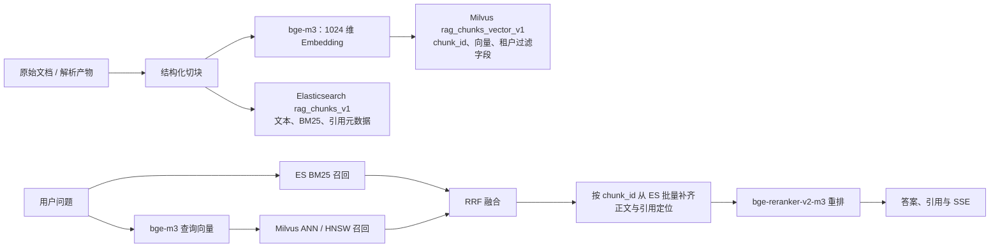

# Milvus 向量检索迁移设计

> 状态：方案设计，尚未替换生产检索链路  
> 分支：`feat/milvus-vector-retrieval`  
> 决策：保留 Elasticsearch 的全文检索能力；将知识库 Chunk 的**向量召回**逐步迁移至 Milvus。第一期不迁移对话记忆索引 `rag_memory_v1`。

## 1. 结论与立项理由

`rag-kb` 当前使用 Elasticsearch 8.13 的 `dense_vector` 同时承载 BM25 和 kNN。这个方案在当前规模正确、简单，也已经完成端到端检索验证；因此本次不是“ES 不能做向量检索”或为了使用新技术而替换。

引入 Milvus 的有效理由是：当知识库持续增长、查询存在明显高峰，或需要独立调优向量召回时，将向量计算、索引构建和容量扩展从 Elasticsearch 的全文检索负载中分离。这样可单独扩容向量查询节点、选择 HNSW/IVF/DiskANN 等向量索引策略，并避免向量建索引与 BM25 写入争抢同一集群的 CPU、内存和磁盘。

这是一项**为规模与性能隔离预留的架构升级**，不是已被当前 5,000 份文档或日均 5,000 次查询证明必须立即进行的优化。是否最终切换，必须由第 6 节的压测、质量评测和运维成本一起决定。

Milvus 是面向高性能、大规模相似度检索的开源向量数据库，支持 HNSW、IVF、DiskANN 等索引及标量过滤；其分布式形态可将查询、写入和索引构建分别扩展。[Milvus 官方概览](https://milvus.io/docs/overview.md) · [Milvus 架构说明](https://milvus.io/docs/architecture_overview.md)

## 2. 不做什么

- 不删除 Elasticsearch，不把 BM25 改为 Milvus 的全文检索；技术文档中的类名、配置键、错误码仍优先由 ES 倒排索引处理。
- 不引入 LangChain、LlamaIndex、RAGFlow 等 RAG 编排框架；调用仍在现有 Spring Boot `ragcore` 内完成。
- 不在第一期迁移 `rag_memory_v1`。会话记忆与用户画像继续由 Elasticsearch 向量索引承载，避免把知识库检索迁移与会话记忆稳定性绑定。
- 不在切换当日删除 ES 中的 `content_vector`。它是快速回滚和影子比对的依据，至少保留一个稳定观察期。

## 3. 目标架构



### 3.1 组件职责

| 组件 | 迁移后职责 | 是否是事实来源 |
|---|---|---|
| PostgreSQL | 知识库、文档、摄取任务、索引状态 | 是（业务状态） |
| MinIO | 原文件、解析产物 | 是（文件） |
| Elasticsearch `rag_chunks_v1` | Chunk 正文、BM25、技术字段、引用定位、按 ID 批量取回 | 是（检索文本投影） |
| Milvus `rag_chunks_vector_v1` | 1024 维向量、向量 ANN、租户/知识库/文档过滤字段 | 否（可重建的向量投影） |
| Embedding 服务 | BGE-M3 文本向量化 | 否 |

关键原则：**Milvus 的命中结果只提供 `chunk_id` 与距离分数；正文、页码和引用元数据仍由 ES 按 ID 批量读取。** 因此不在 Milvus 复制大段正文，降低双写体积，也避免引用内容出现两份不一致。

## 4. 索引与数据模型

### 4.1 Elasticsearch：保留词法索引

现有 `rag_chunks_v1` 暂时保持不变：

- `content_search`：BM25 全文倒排；
- `symbol_names`、`config_keys`、`error_codes`：精确技术标识召回；
- `chunk_id`、`org_id`、`kb_id`、`document_id`：过滤、取回和删除边界；
- `content`、标题路径、页码、行号、版本与 metadata：生成上下文和引用。

观察期内仍写入 `content_vector`，供影子检索和一键回滚。稳定切流后，再单独评审是否创建不含向量的新 ES 词法索引；这不是本次迁移的前置条件。

### 4.2 Milvus Collection：`rag_chunks_vector_v1`

| 字段 | 类型 | 用途 |
|---|---|---|
| `chunk_id` | `VARCHAR`，主键 | 与 ES Chunk 的唯一连接键，建议直接使用现有 UUID 字符串 |
| `embedding` | `FLOAT_VECTOR(1024)` | BGE-M3 dense embedding |
| `org_id` | `VARCHAR` | 强制租户过滤 |
| `kb_id` | `VARCHAR` | 强制知识库过滤 |
| `document_id` | `VARCHAR` | 文档级过滤、删除与重建 |
| `embedding_model` | `VARCHAR` | 防止混用不同模型/维度的向量 |
| `chunk_version` | `VARCHAR` | 支持切块规则升级后的可追溯重建 |
| `indexed_at` | `INT64` | 索引观测与排障 |

首版索引选择：`HNSW` + `COSINE`，初始参数建议 `M=16`、`efConstruction=200`；查询参数从 `ef=128` 起，以真实评测集校准。HNSW 适合持续插入并追求低延迟的知识库检索；若未来规模极大且内存成为主约束，再基于评测比较 IVF/DiskANN，而不是预先猜测。

`org_id`、`kb_id`、可选 `document_id` 必须同时作为标量过滤条件传入 Milvus 查询。服务端绝不接受调用方传来的任意过滤表达式。

## 5. 代码重构边界

当前 `ElasticsearchHybridCandidateSource` 同时实现 BM25 与 kNN，且 `ChunkIndex` 同时承担文本和向量写入。迁移后应按职责拆开，避免再把“混合检索”绑定为某个数据库实现。

```text
现状
ElasticsearchChunkIndex
  └─ 写 ES 文本 + 向量
ElasticsearchHybridCandidateSource
  ├─ searchBm25()
  └─ searchKnn()

目标
ElasticsearchLexicalIndex             # 写 ES 文本、删除、按 chunk_id 批量取回
MilvusVectorIndex                     # upsert/delete 向量
ElasticsearchLexicalCandidateSource   # BM25
MilvusVectorCandidateSource           # ANN + 标量过滤
ChunkHydrator                         # ES mget，补齐 Milvus 命中的正文/定位
HybridRetriever                       # 保持：两路召回 → RRF → Rerank → 拒答
```

建议新增的稳定接口：

```java
interface LexicalCandidateSource {
    List<RetrievedChunk> searchBm25(SearchRequest request);
}

interface VectorCandidateSource {
    List<VectorHit> search(VectorSearchRequest request);
}

interface ChunkHydrator {
    List<RetrievedChunk> findByChunkIds(UUID orgId, UUID kbId, List<String> chunkIds);
}
```

`VectorHit` 只应包含 `chunkId`、`rank`、`distance/score`。`HybridRetriever` 将它经 `ChunkHydrator` 转为 `RetrievedChunk` 后再进入现有 `RrfFusion`，从而不改变 RRF、Rerank、拒答、SSE 和引用协议。

## 6. 写入一致性与迁移阶段

### 6.1 新文档：可恢复双写

摄取 Worker 解析、切块、Embedding 后，创建一条同一批次的索引任务：

1. 写 ES 的文本/元数据投影；
2. Upsert Milvus 向量投影；
3. 两端均成功才将该文档置为 `READY`；
4. 任一步失败，任务保持可重试状态，重试使用稳定 `chunk_id` 幂等 Upsert；
5. 删除文档时，以相同 `org_id + kb_id + document_id` 分别删除两端投影，并记录每端结果。

为避免“ES 成功、Milvus 失败”后任务丢失，正式实现采用 PostgreSQL Outbox/索引状态表，而不是内存中的顺序调用。每个文档记录 `lexical_index_status`、`vector_index_status`、重试次数、最后错误和版本；Worker 可只重放未完成的一端。

### 6.2 历史数据回填

1. 创建空 Collection 和 HNSW 索引；
2. 按 `org_id/kb_id/document_id/chunk_id` 分页扫描 ES 的既有 Chunk；
3. 若 `embedding_model` 和 `chunk_version` 相同，复用 ES 已存的 `content_vector` 回填 Milvus；不一致时重新 Embedding；
4. 每批写入后校验：Chunk 数、去重数、租户分布、维度、随机样本的向量校验和；
5. 回填完成后，补偿扫描双写期间发生变更的文档，直到延迟归零。

### 6.3 分阶段切流

| 阶段 | 线上回答使用 | 目标 | 失败处理 |
|---|---|---|---|
| P0：基线 | ES BM25 + ES kNN | 记录当前质量/延迟/成本 | 无变更 |
| P1：双写 | ES BM25 + ES kNN | 验证 Milvus 可写、可删、可回填 | Milvus 失败不影响现有查询，但阻止最终切流 |
| P2：影子读 | 仍用 ES kNN；后台并发查 Milvus | 比较 TopK 重合、延迟、跨租户结果 | 只记录指标 |
| P3：小流量 | ES BM25 + Milvus kNN | 1% → 10% → 50% 灰度 | 配置开关立即回到 ES kNN |
| P4：主用 | ES BM25 + Milvus kNN | 连续稳定观察后成为默认 | ES kNN 保留为回滚路径 |
| P5：清理 | 另行审批 | 评估是否去除 ES 向量字段 | 不与 P4 同次发布 |

## 7. 检索、权限与降级

一次查询的最终行为：

1. ES BM25 在服务端强制加 `org_id`、`kb_id`、可选 `document_id` 过滤；
2. BGE-M3 生成问题向量；
3. Milvus 使用相同边界字段的受控过滤表达式进行 ANN；
4. 以 `chunk_id` 批量回查 ES；回查再次校验 `org_id`、`kb_id`，任何不一致都丢弃并记录安全事件；
5. 保留现有 RRF 融合、意图权重、Rerank 和拒答策略；
6. Milvus 或 Embedding 不可用时，继续返回 ES BM25 结果；在过渡期可配置回退 ES kNN。

Milvus 的过滤是性能优化和第一道隔离，不是唯一授权边界。授权仍由 Spring Boot 的 JWT/RBAC 与 ES 回查二次校验共同保证。

## 8. 部署、配置与可观测性

### 8.1 部署策略

- 开发/验收：Milvus Standalone + 独立 etcd + 独立对象存储 bucket/凭据。不要让 Milvus 直接共用业务原文件 bucket 的根路径。
- 生产初期：单机 Standalone 仅用于容量验证，不宣称高可用。
- 生产规模化：按公司 Kubernetes 与高可用要求部署 Milvus 集群；Milvus 的索引、日志和对象存储依赖应进入备份、监控、TLS、鉴权和容量治理范围。

建议配置（具体凭据仅放 `.env` 或密钥管理）：

```properties
RAG_VECTOR_PROVIDER=elasticsearch|milvus|shadow
RAG_MILVUS_ENDPOINT=http://milvus:19530
RAG_MILVUS_COLLECTION=rag_chunks_vector_v1
RAG_MILVUS_DIMENSIONS=1024
RAG_MILVUS_METRIC_TYPE=COSINE
RAG_MILVUS_INDEX_TYPE=HNSW
RAG_MILVUS_HNSW_M=16
RAG_MILVUS_EF_CONSTRUCTION=200
RAG_MILVUS_SEARCH_EF=128
RAG_MILVUS_TIMEOUT_MS=3000
```

### 8.2 必须新增的指标与告警

- 双写成功率、积压量、重试次数、ES/Milvus 投影差异数；
- Milvus 查询 P50/P95/P99、`ef`、候选数、超时和回退率；
- 向量结果与 ES 基线的 Top-10 重合率、RRF 后 Top-5 差异率；
- 文档删除的双端完成率；
- 任一 Milvus 结果被 ES 租户二次校验拒绝时的安全告警（应恒为零）。

## 9. 验收门槛与决策门

切换 Milvus 前必须同时满足：

| 维度 | 门槛 |
|---|---|
| 数据一致性 | ES/Milvus 活跃 Chunk 数一致；抽样 `chunk_id`、组织、知识库、模型版本、维度均一致 |
| 权限 | 跨组织、跨知识库、指定文档过滤自动化用例 100% 通过 |
| 写入可靠性 | 重试、删除、Worker 故障接管后两端最终一致；无孤儿向量 |
| 检索质量 | 使用既有 150 题评测集，主指标不得低于 ES 基线；差异题必须人工归因 |
| 性能 | 在目标并发与文档规模下，端到端 P95 与 ES 基线相比有明确收益或至少无退化；同时记录单位查询资源成本 |
| 可回滚性 | 关闭 `RAG_VECTOR_PROVIDER=milvus` 后无需重建索引即可恢复 ES kNN |

若 Milvus 没有带来可观测的延迟、吞吐、容量或运维收益，就停留在 P2/P3，不进入 P4。这是正确结果，不应为了“用了 Milvus”而切换。

## 10. 实施任务顺序

1. 建立性能基线：补齐当前 ES kNN 的压测、P95/P99、候选数、评测报告。
2. 新增 Milvus 开发/验收部署和健康检查，不接入主链路。
3. 落地 `VectorCandidateSource`、`ChunkHydrator` 等端口，并将 ES 实现迁到新端口，行为不变。
4. 新增 `MilvusVectorIndex`、`MilvusVectorCandidateSource`、Collection 初始化和受控过滤。
5. 新增索引状态/Outbox 双写机制、幂等与删除补偿；补齐单元和集成测试。
6. 执行历史回填、完整性校验与补偿扫描。
7. 实现影子读、差异审计和指标面板；运行既有离线评测集。
8. 按 P3 灰度策略切流；满足验收门槛后再决定 P4。
9. 稳定观察后单独评审 ES 向量字段和对话记忆向量索引是否迁移。

## 11. 待确认事项

1. 目标规模：未来 12 个月预计 Chunk 数、峰值 QPS、允许的 P95 延迟和可用性目标。
2. 公司生产环境：是否已有 Kubernetes、可复用的 etcd/对象存储、统一监控与密钥管理。
3. 是否接受先上 Milvus Standalone 做真实压测，再决定是否建设高可用集群。
4. 是否把“Milvus 查询异常回退 ES kNN”保留整个观察期，还是仅在影子/灰度期保留。
5. 向量模型升级策略：维度或模型版本变化时，采用新 Collection 影子回填而不是原地覆盖。
