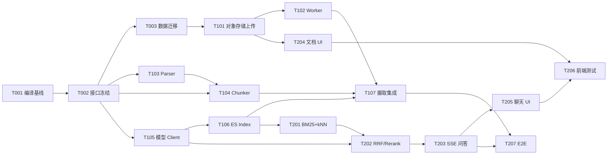

# 自研 RAG Core 重构任务清单与多 Agent 分工

> **归档状态（2026-07-14）**：本文档是 P0-P3 阶段（T001-T207）多 Agent 并行开发时的任务分工计划，全部任务已完成并合并进 main（PR #4-#10）。
> 保留仅供追溯当时的分工与依赖设计；**当前实现状态请看**
> [../自研RAG核心重构架构设计.md](../自研RAG核心重构架构设计.md) 第 12 节，**不要**依据本文档判断当前进度。
>
> 项目：rag-kb 内部技术文档知识库
>
> 目标：以自研 RAG Core 替换已删除的 RAGFlow 主链路，支持技术文档的解析、索引、检索、引用与问答。
>
> 依据：[自研 RAG 核心重构架构设计](../自研RAG核心重构架构设计.md)、[RAG 重构可复用资产清单](../RAG重构可复用资产清单.md)。

## 1. 开发总原则

1. 每位 Agent 必须在独立分支或 Worktree 工作，禁止直接改 `main`。
2. 新 RAG 代码统一放入 `backend/src/main/java/com/diit/ragkb/ragcore/`。
3. 不重新引入 RAGFlow、LangChain、LlamaIndex、Dify 等高层 RAG 编排框架。
4. Elasticsearch、PostgreSQL、MinIO、Redis、Xinference/vLLM 是允许使用的基础设施。
5. 任何检索必须由服务端注入 `org_id` 与 `kb_id`，禁止接受客户端自由构造过滤条件。
6. 所有任务均须带测试；未通过跨组织隔离、空召回拒答和引用定位测试，不得合并。
7. rag1 是公司内部可复用资产；rag2 复制前补齐上游许可证登记；rag3 为 MIT，移植时保留版权与许可说明。

## 2. 模型角色与任务边界

| Agent 标签 | 最适合的工作 | 禁止改动的共享区域 | 交付物 |
|---|---|---|---|
| GPT-5.6 | 架构收口、ES 索引、混合检索、模型 Client、RAG API 与安全边界 | Parser 具体实现、前端 UI | `ragcore.index/retrieval/embedding/rerank/generation`、接口契约、检索测试 |
| DeepSeek-V4 | 文档解析、技术切块、对象存储、摄取任务 Worker、失败重试 | ES 检索 DSL、问答 Prompt、前端 UI | `ragcore.parser/chunk/ingestion`、摄取状态机、解析测试 |
| MiniMax M3 | 前端文档工作区、SSE 交互、引用卡片、评测集与回归测试、文档同步 | ES mapping、Parser 核心算法、模型 Client | Vue 页面/API 层、评测工具、E2E/组件测试、使用文档 |

> 说明：这里的模型名称是任务标签和建议分工；执行环境必须由项目负责人将对应任务交给实际可用的模型/Agent。

## 3. 阶段与任务统计

| 阶段 | 任务数 | GPT-5.6 | DeepSeek-V4 | MiniMax M3 | 完成条件 |
|---|---:|---:|---:|---:|---|
| P0：工程恢复与契约冻结 | 5 | 3 | 1 | 1 | 后端可编译，核心接口和数据状态冻结 |
| P1：摄取与索引闭环 | 7 | 3 | 4 | 0 | 文档可从上传进入 READY，并写入 ES |
| P2：检索问答与前端闭环 | 7 | 3 | 0 | 4 | 可检索、拒答、流式回答和引用展示 |
| P3：质量、运营与发布 | 6 | 2 | 1 | 3 | 有评测、审计、压测、回滚与发布证据 |
| 合计 | 25 | 11 | 6 | 8 | — |

## 4. P0：工程恢复与契约冻结

### T001：修复后端编译基线

| 字段 | 内容 |
|---|---|
| 负责人 | GPT-5.6 |
| 类型 | 配置/测试 |
| 复杂度 | 低 |
| 前置 | 无 |
| 范围 | 修复当前 `MemberService.java` 的 Java 17 switch 语法编译问题；运行 `mvn test`，记录其余失败项 |
| 验收 | `mvn test` 至少完成编译阶段；任何失败均定位到具体测试而非编译错误 |
| 禁止 | 不顺手重构成员权限逻辑，不修改 RAG 以外的业务语义 |

### T002：冻结 RAG Core 接口与状态机

| 字段 | 内容 |
|---|---|
| 负责人 | GPT-5.6 |
| 类型 | 后端/设计 |
| 复杂度 | 中 |
| 前置 | T001 |
| 范围 | 建立 `DocumentParser`、`Chunker`、`EmbeddingClient`、`ChunkIndex`、`Retriever`、`RerankerClient`、`AnswerGenerator` 接口；定义 `Chunk`、`RetrievedChunk`、`Citation`、`IngestionStatus` DTO |
| 验收 | 接口不依赖 Controller、ES SDK 或具体模型；公开 JavaDoc 与最小编译测试 |
| 交接 | 将接口签名写入 PR 描述，供 DeepSeek-V4/MiniMax M3 对接 |

### T003：创建自研 RAG 数据迁移

| 字段 | 内容 |
|---|---|
| 负责人 | DeepSeek-V4 |
| 类型 | 数据库/配置 |
| 复杂度 | 中 |
| 前置 | T002 的状态枚举与命名 |
| 范围 | 新增 `ingestion_job` 表、文档对象存储定位字段、错误/重试字段；历史 RAGFlow migration 不回删。T002 未合并前仅可提交设计稿，不可合并 SQL |
| 验收 | Flyway 可在空库和已有库执行；任务可幂等创建；不再新增 RAGFlow 字段 |
| 禁止 | 修改历史 `V001–V004` migration；删除已有生产数据字段 |

### T004：安全基线修复

| 字段 | 内容 |
|---|---|
| 负责人 | GPT-5.6 |
| 类型 | 安全/配置/测试 |
| 复杂度 | 中 |
| 前置 | T001 |
| 范围 | JWT 密钥 fail-fast、登录/注册 Redis 限流、健康检查脱敏、认证失败审计、Bootstrap 路径精确匹配 |
| 验收 | 安全配置测试通过；缺少 JWT 密钥无法启动；认证失败有审计日志 |

### T005：前端重构占位与契约测试

| 字段 | 内容 |
|---|---|
| 负责人 | MiniMax M3 |
| 类型 | 前端/测试 |
| 复杂度 | 低 |
| 前置 | 本文第 11 节的 v0 契约；T002 合并后按最终签名做一次对齐 |
| 范围 | 保持当前“RAG 核心重构中”页面；建立后续 Document、Query、Citation TypeScript 类型和 API Mock 测试骨架 |
| 验收 | `pnpm build`、`pnpm test` 通过；不恢复旧 RAGFlow UI 代码 |

## 5. P1：摄取与索引闭环

### T101：对象存储与文档上传 API

| 字段 | 内容 |
|---|---|
| 负责人 | DeepSeek-V4 |
| 类型 | 后端/存储 |
| 复杂度 | 中 |
| 前置 | T003 |
| 范围 | MinIO/S3 Adapter；恢复文档上传 API，但上传只保存原文件、创建 `ingestion_job` 并返回 `QUEUED` |
| 验收 | 支持 Markdown、TXT、代码、YAML/JSON/XML、DOCX、PDF 白名单；文件路径按 `org/kb/document` 隔离 |

### T102：摄取任务 Worker 与失败重试

| 字段 | 内容 |
|---|---|
| 负责人 | DeepSeek-V4 |
| 类型 | 后端/异步 |
| 复杂度 | 高 |
| 前置 | T003、T101 |
| 范围 | 基于任务表轮询/领取任务、状态推进、重试次数、死信状态、管理员手动重试、删除补偿 |
| 验收 | 同一文档重复投递不生成重复任务；失败可见、可重试；HTTP 上传不执行完整解析 |

### T103：技术文档 Parser Adapter

| 字段 | 内容 |
|---|---|
| 负责人 | DeepSeek-V4 |
| 类型 | 后端/解析 |
| 复杂度 | 高 |
| 前置 | T002 |
| 范围 | 实现 Markdown、TXT、源代码、YAML/JSON/XML、DOCX、文本型 PDF Parser；输出正文、标题层级、页码/行号、语言与文件路径 |
| 验收 | 每种格式有脱敏样例；解析失败进入明确 FAILED 状态；扫描 PDF 标记为不支持或低质量，不静默成功 |

### T104：TechnicalChunker

| 字段 | 内容 |
|---|---|
| 负责人 | DeepSeek-V4 |
| 类型 | 后端/算法 |
| 复杂度 | 高 |
| 前置 | T002、T103 |
| 范围 | 基于 rag3 结构化切块思想实现标题、段落、函数、类、代码围栏和配置节边界；支持 overlap 与 metadata |
| 验收 | 代码围栏不被从中切断；chunk 含 heading/path/page/line；单测覆盖超长块、空块和中英文文本 |

### T105：Embedding 与 Rerank Client

| 字段 | 内容 |
|---|---|
| 负责人 | GPT-5.6 |
| 类型 | 后端/模型服务 |
| 复杂度 | 中 |
| 前置 | T002 |
| 范围 | 基于 rag1 内部 Java 资产改造 OpenAI 兼容 Embedding/Rerank Client，支持批量、超时、模型版本和可选降级 |
| 验收 | Mock Server 测试批量调用、超时和失败；无 API Key/内网地址硬编码 |

### T106：ES Chunk Index 与索引版本

| 字段 | 内容 |
|---|---|
| 负责人 | GPT-5.6 |
| 类型 | 后端/搜索 |
| 复杂度 | 高 |
| 前置 | T002、T105 |
| 范围 | 设计 `rag_chunks_v1` mapping；实现 Bulk Upsert/Delete、按 document 重建、版本字段、服务端 org/kb 过滤 |
| 验收 | `content`、`content_search`、`content_vector`、技术标识字段和位置 metadata 可写入；重试不产生重复 chunk |

### T107：摄取到索引集成

| 字段 | 内容 |
|---|---|
| 负责人 | DeepSeek-V4（实现）+ GPT-5.6（接口评审） |
| 类型 | 集成/测试 |
| 复杂度 | 高 |
| 前置 | T102、T104、T105、T106 |
| 范围 | Worker 串联 Parser → Chunker → Embedding → ES Bulk，更新 Document/Job 状态 |
| 验收 | 一份技术 Markdown 和一份 PDF 可从上传进入 READY；删除后 ES 无残留 chunk |

## 6. P2：检索问答与前端闭环

### T201：BM25 + kNN Query Builder

| 字段 | 内容 |
|---|---|
| 负责人 | GPT-5.6 |
| 类型 | 后端/检索 |
| 复杂度 | 高 |
| 前置 | T106 |
| 范围 | 直接使用 ES Java Client 完成 BM25 top30、kNN top30、强制 org/kb 过滤与技术标识字段优先匹配 |
| 验收 | 类名、错误码、配置 key 可精确命中；跨组织/跨 KB 查询无结果 |

### T202：RRF、Rerank 与拒答

| 字段 | 内容 |
|---|---|
| 负责人 | GPT-5.6 |
| 类型 | 后端/算法 |
| 复杂度 | 高 |
| 前置 | T201、T105 |
| 范围 | RRF 融合、候选去重、可选 Rerank、阈值判断、空召回/低置信拒答；参考 rag3 算法 |
| 验收 | 单测覆盖 RRF 排序、Rerank 失败降级、空上下文不调用 LLM |

### T203：Prompt、引用与 SSE 问答 API

| 字段 | 内容 |
|---|---|
| 负责人 | GPT-5.6 |
| 类型 | 后端/API |
| 复杂度 | 高 |
| 前置 | T202 |
| 范围 | 组装技术文档 Prompt；实现 `chunk/source/refusal/done/error` SSE 协议；引用由服务端最终 chunk 构造 |
| 验收 | 答案、拒答和来源事件均可稳定解析；引用含文档名、标题路径、页码/行号、片段与分数 |

### T204：文档工作区 UI

| 字段 | 内容 |
|---|---|
| 负责人 | MiniMax M3 |
| 类型 | 前端/页面 |
| 复杂度 | 中 |
| 前置 | T101 API 契约 |
| 范围 | 恢复文档上传、状态、失败原因、重试与删除 UI；不包含旧 RAGFlow 轮询语义 |
| 验收 | 文档状态可读、失败可重试、无权限操作正确提示 |

### T205：聊天、引用与拒答 UI

| 字段 | 内容 |
|---|---|
| 负责人 | MiniMax M3 |
| 类型 | 前端/组件 |
| 复杂度 | 中 |
| 前置 | T203 SSE 协议 |
| 范围 | SSE 文本增量、来源卡片、拒答状态、网络中断、取消请求与知识库切换 |
| 验收 | `source` 与 `refusal` 事件可视化；用户能定位引用原文 |

### T206：前端 API 与组件测试

| 字段 | 内容 |
|---|---|
| 负责人 | MiniMax M3 |
| 类型 | 测试 |
| 复杂度 | 中 |
| 前置 | T204、T205 |
| 范围 | API Mock、上传状态、SSE 分包、引用卡片、拒答、取消请求测试 |
| 验收 | `pnpm test` 通过，关键交互有回归测试 |

### T207：端到端试点验收

| 字段 | 内容 |
|---|---|
| 负责人 | MiniMax M3（主）+ GPT-5.6（检索支持） |
| 类型 | 测试/验收 |
| 复杂度 | 中 |
| 前置 | T107、T203、T204、T205 |
| 范围 | 使用脱敏技术文档完成“上传 → READY → 问答 → 引用 → 拒答”E2E 场景 |
| 验收 | 全流程可演示，测试证据与截图/日志归档 |

## 7. P3：质量、运营与发布

### T301：离线评测框架与技术问答集

| 字段 | 内容 |
|---|---|
| 负责人 | MiniMax M3 |
| 类型 | 测试/数据 |
| 复杂度 | 中 |
| 前置 | T201、T202 |
| 范围 | 建立 JSONL 评测格式、至少 50 个脱敏技术问题、期望来源、Recall@5/MRR/拒答指标计算 |
| 验收 | 一条命令可输出评测报告；模型/切块版本可追溯 |

### T302：检索可观测性与审计

| 字段 | 内容 |
|---|---|
| 负责人 | GPT-5.6 |
| 类型 | 后端/运维 |
| 复杂度 | 中 |
| 前置 | T203 |
| 范围 | traceId、检索耗时、命中 chunk、模型版本、Rerank 降级、拒答原因、token 统计 |
| 验收 | 单次请求可从日志追踪到最终引用，不记录敏感正文 |

### T303：索引重建与数据生命周期

| 字段 | 内容 |
|---|---|
| 负责人 | DeepSeek-V4 |
| 类型 | 后端/运维 |
| 复杂度 | 中 |
| 前置 | T107 |
| 范围 | 单文档重建、按 KB 重建、模型/切块版本变更重建、删除对账 |
| 验收 | 重建过程可中断恢复；无孤儿对象或 ES 残留 |

### T304：性能与容量压测

| 字段 | 内容 |
|---|---|
| 负责人 | GPT-5.6 |
| 类型 | 测试/性能 |
| 复杂度 | 中 |
| 前置 | T107、T203 |
| 范围 | 摄取吞吐、ES 检索 P95、端到端问答 P95、模型并发与资源基线 |
| 验收 | 输出容量报告和扩容阈值；识别是否需要消息队列 |

### T305：用户使用说明与运维手册

| 字段 | 内容 |
|---|---|
| 负责人 | MiniMax M3 |
| 类型 | 文档 |
| 复杂度 | 低 |
| 前置 | T204、T205、T207 |
| 范围 | 重写 README、用户手册、部署参数、故障排查；删除所有 RAGFlow 运行说明 |
| 验收 | 文档与实际 API/UI 一致，可供新成员独立部署与使用 |

### T306：发布回归与安全复核

| 字段 | 内容 |
|---|---|
| 负责人 | MiniMax M3（发布清单）+ GPT-5.6（安全复核） |
| 类型 | 测试/发布 |
| 复杂度 | 中 |
| 前置 | T301–T305 |
| 范围 | 全量测试、跨组织攻击用例、依赖漏洞扫描、迁移演练、回滚演练 |
| 验收 | 发布检查表签字；无 HIGH/CRITICAL 安全问题 |

## 8. 关键依赖关系

## 9. 第一轮并行启动清单

三位 Agent 现在可立即并行开始，但必须各自使用独立 Worktree：

| Agent | 立即开始的任务 | 分支建议 | 产出时间点 |
|---|---|---|---|
| GPT-5.6 | T001 + T002 + T004 | `feat/rag-core-contract-security` | 先提交可编译基线、接口契约、安全修复 |
| DeepSeek-V4 | T003 的 migration 设计 + T103/T104 的 Parser/Chunker 单测实现 | `feat/rag-ingestion-parser-chunker` | 不等待 ES；先交付纯 Java 解析与切块模块 |
| MiniMax M3 | T005 + T301 的评测数据格式和前端 Mock 骨架 | `feat/rag-frontend-eval-foundation` | 不等待后端实现；基于第 11 节 v0 契约交付 TypeScript 类型、Mock 与脱敏题库模板 |

### 第一轮合并顺序

1. 先合并 GPT-5.6 的 T001/T002，冻结接口命名。
2. DeepSeek-V4 按冻结接口调整后合并 T003/T103/T104。
3. GPT-5.6 合并 T105/T106，DeepSeek-V4 完成 T101/T102/T107。
4. 再并行进入 T201–T207。

## 10. 每个 Agent 的提交要求

每个任务 PR 必须包含：

- 对应任务 ID，例如 `feat: 完成 T104 技术文档切块`；
- 复用来源与许可/内部资产说明；
- 单元测试或组件测试命令及结果；
- 跨租户影响说明；
- 未完成项与后续依赖；
- 不得混入 `.context/`、密钥、真实内部技术文档或本地构建产物。

## 11. T002 需要冻结的 v0 接口契约

这一节是为了让 MiniMax M3 和 DeepSeek-V4 可以立刻开工的**设计契约**。GPT-5.6 的 T002 必须以此为基线落地 Java 接口；若确需调整，必须更新本节并在 PR 中说明兼容影响。

### 11.1 核心状态与数据结构

| 名称 | v0 定义 | 使用方 |
|---|---|---|
| `IngestionStatus` | `QUEUED`、`PARSING`、`CHUNKING`、`EMBEDDING`、`INDEXING`、`READY`、`FAILED`、`DELETING` | T003、T101、T102、T204 |
| `ParsedDocument` | `documentId`、`contentType`、`sourcePath`、`sections`、`metadata`；section 至少含 `text`、`headingPath`、`pageNo`、`lineStart`、`lineEnd` | T103、T104 |
| `Chunk` | `id`、`orgId`、`kbId`、`documentId`、`ordinal`、`content`、`headingPath`、`sourcePath`、`pageNo`、`lineStart`、`lineEnd`、`language`、`contentHash`、`metadata` | T104、T106、T201、T203 |
| `RetrievedChunk` | `chunk`、`bm25Rank`、`vectorRank`、`rrfScore`、`rerankScore`、`finalScore` | T201、T202、T203、T301 |
| `Citation` | `documentId`、`documentName`、`headingPath`、`snippet`、`pageNo`、`lineStart`、`lineEnd`、`score` | T203、T205、T206 |
| `QueryEvent` | `chunk`、`source`、`refusal`、`done`、`error` 五类 SSE 事件 | T005、T203、T205 |

### 11.2 核心接口

| 接口 | 最小职责 | 实现任务 |
|---|---|---|
| `DocumentParser` | `supports(type)`、`parse(source)`，只负责抽取结构，不调用模型或 ES | T103 |
| `Chunker` | `chunk(parsedDocument, options)`，输出带定位 metadata 的 chunks | T104 |
| `EmbeddingClient` | `embedBatch(texts)`，返回与输入等长的向量及模型版本 | T105 |
| `RerankerClient` | `rerank(query, candidates, topK)`，不可用时抛可识别的降级异常 | T105/T202 |
| `ChunkIndex` | `upsert(chunks, vectors)`、`deleteByDocument()`、`search()` | T106/T201 |
| `Retriever` | `retrieve(orgId, kbId, query, options)`，强制服务端租户过滤 | T201/T202 |
| `AnswerGenerator` | `stream(question, contexts, listener)`；空 contexts 不调用模型 | T203 |

### 11.3 允许并行、不允许假设的内容

- MiniMax M3 可以按本节的 `IngestionStatus`、`Citation`、`QueryEvent` 建 TypeScript 类型和 Mock；不要自创事件名。
- DeepSeek-V4 可以按 `ParsedDocument`、`Chunk` 和 `DocumentParser/Chunker` 开发纯 Java 模块与测试；不要自行增加数据库字段或改 ES mapping。
- 只有 GPT-5.6 可以修改本节对应的接口签名、ES mapping 和模型 Client 契约；改动需先通知其他 Agent。

## 12. 每个任务的源码参考与复用动作矩阵

以下路径均从工作区根目录开始。为避免表格重复，rag1 中的 `.../` 固定展开为 `rag系统1/bd2025-001/server/bussiness-service/model-service/model-service-domain/src/main/java/com/diit/model/`；rag2 中的 `app/service/core/` 固定展开为 `rag系统2/swxy/backend/app/service/core/`；rag3 中的 `rag_project/` 固定展开为 `rag系统3/rag-from-zero/rag_project/`。`直接改造`只适用于 rag1 公司内部 Java 资产；`移植`表示在 Java 中重写算法；`参考`表示不得原样复制。

| 任务 | rag1 精确参考 | rag2 精确参考 | rag3 精确参考 | 明确复用动作 |
|---|---|---|---|---|
| T001 | 无 RAG 复用；仅修复 `rag0/.../MemberService.java` | 无 | 无 | 只恢复编译基线，禁止扩范围 |
| T002 | `.../service/retrieval/RetrievalStrategy.java`、`RetrievalStrategyFactory.java` | 无 | `rag_project/src/pipeline.py` | rag1 直接改造策略接口；rag3 参考模块装配边界 |
| T003 | 无直接代码 | 无 | `rag_project/src/config.py` | 以 rag0 既有 Flyway 为基线，rag3 只参考配置分层；不改历史 migration |
| T004 | 无 | 无 | 无 | 复用 rag0 `TODOS.md` 和现有认证测试，非 RAG 资产 |
| T005 | 旧 rag0 前端快照：`git show 4c41e4f^:frontend/src/api/queryApi.ts`、`types/query.ts` | 无 | `rag_project/src/generator.py` | 旧前端仅复用 SSE 解析形态；rag3 参考 `Citation/拒答` 类型语义，不恢复旧 API |
| T101 | rag1 `.../core/mineru/MinerUService.java`（仅外部文件服务 Adapter 模式） | `app/service/core/file_parse.py` | `rag_project/src/loader.py` | rag2/3 参考文件处理顺序；新代码自行实现 MinIO Adapter 与异步上传 |
| T102 | rag1 `.../service/impl/ChatRecordServiceImpl.java`（仅重试/缓存思路） | 无 | 无 | 任务表 Worker 自研；不复制 rag1 Kafka 逻辑 |
| T103 | rag1 `.../core/mineru/MinerUService.java`（复杂 PDF 备用） | `app/service/core/deepdoc/parser/{pdf,docx,excel,html,json,markdown,txt,ppt}_parser.py` | `rag_project/src/loader.py` | rag2 用作格式能力清单；rag3 参考加载器；Parser 用 Java 库自研 |
| T104 | 无 | `app/service/core/rag/nlp/__init__.py` 的 `naive_merge`（反例基线） | `rag_project/src/chunker.py` | 按 MIT 将 rag3 结构切块算法移植到 Java；rag2 仅用于对比简单 token 切块 |
| T105 | `.../service/EmbeddingService.java`、`impl/EmbeddingServiceImpl.java`、`ReRankingServiceImpl.java`、对应 Config | `app/service/core/rag/nlp/model.py` | `rag_project/src/embedder.py`、`reranker.py` | rag1 Java Client 直接改造；rag2/3 用于批量与模型行为测试 |
| T106 | `.../core/elasticsearch/client/VectorContentClient.java` | `app/service/core/rag/conf/mapping.json`、`utils/es_conn.py` | 无 | rag1 直接改造 Bulk/失败统计；rag2 参考字段 mapping；租户过滤自研 |
| T107 | `VectorContentClient.java` | `app/service/core/file_parse.py` | `rag_project/src/pipeline.py` | 用 rag2/3 明确流水线顺序，接入自研 Worker 与 rag1 ES Client |
| T201 | `.../service/retrieval/impl/ElasticsearchRetrievalStrategy.java` | `app/service/core/rag/nlp/search_v2.py`、`query.py` | `rag_project/src/retriever.py` | rag2 参考 BM25+kNN DSL；rag3 移植候选去重；rag1 复用 Java 服务分层 |
| T202 | `.../service/impl/ReRankingServiceImpl.java` | `search_v2.py` 的 rerank/阈值逻辑 | `retriever.py`、`reranker.py`、`generator.py` | rag3 移植 RRF/空召回规则；rag1 直接改造 Rerank Client；rag2 仅参考阈值 |
| T203 | `.../util/PromptTemplates.java`、`.../service/impl/ChatServiceImpl.java` | `app/service/core/chat.py` | `rag_project/src/generator.py` | rag1 复用 Java SSE/Prompt 模式；rag3 移植拒答与来源构造；rag2 仅参考事件分流 |
| T204 | 旧 rag0 `DocumentTable.vue`（`git show 4c41e4f^:frontend/src/components/DocumentTable.vue`） | 无 | 无 | 在旧页面交互基础上重写为任务状态 UI，不复原 RAGFlow 轮询 |
| T205 | 旧 rag0 `ChatPanel.vue`、`SourceCard.vue` | 无 | `rag_project/src/generator.py` | 复用旧前端 SSE 呈现；按 rag3 的“服务端引用/拒答”语义新增事件 |
| T206 | 旧 rag0 `queryApi.test.ts`、`chatStore.test.ts` | 无 | `rag_project/tests/smoke_test.py` | 复用旧 Mock/SSE 分包测试；rag3 参考拒答和引用断言 |
| T207 | 无 | 无 | `rag_project/tests/smoke_test.py` | 将 rag3 冒烟测试的五项断言映射为真实 E2E 场景 |
| T301 | 无 | 无 | `rag_project/tests/sample_qa.jsonl`、`chapters/ch10-evaluation/eval_demo.py` | 直接复用 JSONL 结构和指标计算思路，替换为脱敏技术问题 |
| T302 | rag1 `ChatServiceImpl.java`、`RAGFlowRetrievalStrategy.java`（日志/缓存键思路） | 无 | 无 | 只复用 trace、耗时、缓存键思路；可观测字段自研 |
| T303 | rag1 `VectorContentClient.java` | `app/service/core/file_parse.py` | `rag_project/src/pipeline.py` | 复用批量删除/重建的工程思路；重建任务自研 |
| T304 | rag1 检索缓存与模型配置实现 | 无 | 无 | 参考指标采集点；压测脚本与阈值自研 |
| T305 | 无 | 无 | `rag_project/README.md` | 以 rag0 实际实现为准，rag3 README 参考“上手与边界”写法；删除旧 RAGFlow 说明 |
| T306 | rag1 策略降级与日志模式 | rag2 风险清单章节 | `rag_project/tests/smoke_test.py` | 汇总三者的失败场景，形成发布检查表与安全回归 |

## 13. 项目经理执行决策（已拍板）

### 13.1 脏改动处理

- **不丢弃，不带入任何 RAG 功能分支。**
- `README.md` 和 `docs/user-guide.md` 仍描述已删除的 RAGFlow 功能，应保存为命名 stash，待 T305 按自研 RAG 实现重写后再恢复参考。
- `.context/` 是本地运行记录，不提交、不 stash 到功能分支。
- 建议在开始 Agent 开发前执行：`git stash push -u -m "wip: 旧RAGFlow文档待T305重写" -- README.md docs/user-guide.md`，随后确认 `.context/` 仍保持本地未跟踪状态。

### 13.2 第一轮是否启动

**批准立即启动。**

- MiniMax M3：立即执行 T005 + T301，不等待后端；严格使用第 11 节 v0 类型与事件名。
- DeepSeek-V4：立即执行 T103/T104 的纯 Java Parser/Chunker 与单测；T003 只能先完成 migration 设计，等 T002 合并后再提交 SQL。
- GPT-5.6：优先级最高，先完成 T001 + T002 + T004；T002 是第一轮唯一的合并门禁。

### 13.3 合并门禁

1. GPT-5.6 的 T002 合并前，不合并任何依赖该接口的数据库 migration、Controller 或 ES mapping。
2. MiniMax M3 的 Mock 允许先合并，但必须在 T203 完成后更新为真实 API 并保留测试。
3. DeepSeek-V4 的 Parser/Chunker 可以先合并，只要不依赖未冻结 DTO；否则在自己的分支等待契约变更。
