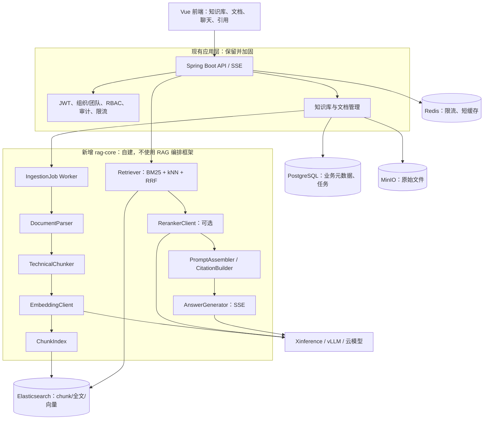
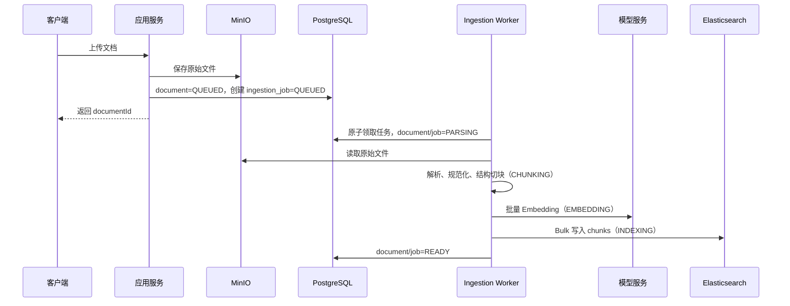
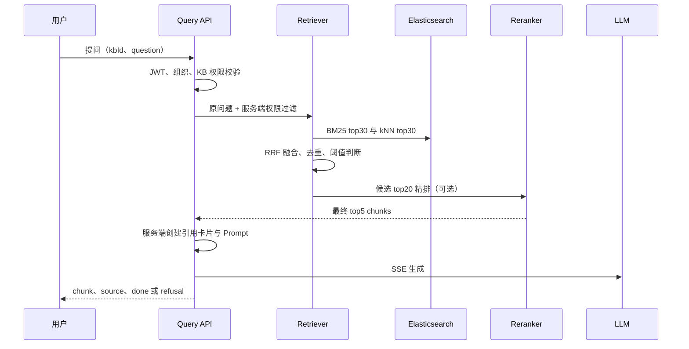

# rag-kb 自研 RAG 核心重构架构设计

> 状态：P1 摄取与索引代码已实现，待真实 ES/模型环境验收；P2 检索问答待实施。
>
> 读者：项目经理、技术经理、后端/前端/算法开发 Agent、测试 Agent
>
> 目标：为内部技术文档建立可追溯、可评估、可扩展的问答与检索能力；保留现有 rag-kb 的企业应用层，移除 RAGFlow 对 RAG 主链路的依赖。

## 1. 背景与问题

团队当前主要在群聊中寻找技术文档。接口说明、设计文档、Markdown、配置文件和代码片段分散，普通关键词搜索难以同时满足以下需求：

- 通过自然语言问题找到正确文档和代码片段；
- 精确匹配类名、方法名、配置项、错误码、文件路径等技术标识；
- 对复杂格式文档保留标题层级、代码块和来源位置；
- 回答必须能展示原文引用，不能仅给出无法核验的模型结论；
- 按组织、团队和知识库严格隔离数据。

现有 rag-kb 已实现账号、组织/团队/成员、RBAC、知识库、文档状态和 SSE 前端。其 RAG 部分由 `RagFlowClient` 调用 RAGFlow 完成解析、切块、检索和生成。本次重构不推翻应用层，而是将这一黑盒主链路替换为自建、模块化的 RAG Core。

## 2. 项目目标、非目标与成功标准

### 2.1 第一阶段目标

1. 支持 Markdown、纯文本、代码文件、PDF、DOCX 技术文档的上传、解析、索引和问答。
2. 能回答接口、配置、类/方法、部署与故障排查问题，并返回文件名、标题、片段和位置。
3. 同时支持关键词精确命中和语义相似检索。
4. 空召回或低置信结果必须拒答或明确说明资料不足。
5. 复用现有多租户、RBAC、SSE、知识库和文档管理接口。
6. 不使用 RAGFlow、LangChain、LlamaIndex、Dify 等高层 RAG 编排框架作为主链路。

### 2.2 非目标

- 第一阶段不做 Agent、工作流、网页抓取、知识图谱、图检索。
- 第一阶段不做 OCR 训练、表格识别模型训练或多模态图片问答。
- 第一阶段不做多轮记忆压缩；问答可保持无状态，或仅传入有限历史。
- 第一阶段不引入 Kafka 等消息队列；采用数据库任务表和 Worker 实现异步摄取。
- 第一阶段不承诺自动理解所有扫描 PDF；复杂 OCR 通过后续解析适配器补齐。

### 2.3 试点验收标准

试点语料为真实内部技术文档，先人工整理至少 50 个高频问题：

| 指标 | 第一阶段验收线 |
|---|---|
| Recall@5 | 不低于 80% |
| 引用可用率 | 不低于 95%，每个引用能定位到授权文档及原文片段 |
| 空资料拒答正确率 | 不低于 95% |
| 检索阶段 P95 | 不高于 2 秒（试点规模） |
| 含模型生成的端到端 P95 | 不高于 10 秒，具体取决于模型服务 |
| 跨组织越权读取 | 0 容忍，自动化测试必须覆盖 |

这些数值是试点门槛，不是上线前凭空承诺；应以评测集和压测结果记录为准。

## 3. 核心架构决策

| 决策 | 选择 | 原因 |
|---|---|---|
| 应用形态 | 保持 Spring Boot 单体模块化，不拆微服务 | 当前规模是内部技术文档检索，先降低部署和调用复杂度 |
| RAG 编排 | 自建 RAG Core | 切块、检索融合、拒答、引用和评估必须可读、可测、可替换 |
| 关系数据 | PostgreSQL | 继续保存组织、权限、知识库、文档、任务、会话元数据 |
| 原始文件 | MinIO/S3 兼容对象存储 | 原文件不再只存在于 RAGFlow，保证可重建索引 |
| 检索索引 | Elasticsearch | 同时提供 BM25、过滤、向量 kNN 和高亮；直接用原生 Java 客户端 |
| 模型调用 | OpenAI 兼容 HTTP 客户端，优先 Xinference/vLLM | 使 Embedding、Rerank、LLM 可独立替换与扩缩容 |
| 异步摄取 | PostgreSQL 任务表 + Worker | 首期足够轻量，具备幂等、可重试、可观测；压力增长后再升级消息队列 |
| 复杂 PDF | 解析器适配器 | 第一阶段采用轻量解析；需要 OCR/表格时再接 MinerU 或其他服务，不污染主流程 |
| 检索融合 | BM25 + 向量 kNN + RRF + 可选 Rerank | 同时保障技术标识精确命中与自然语言语义召回 |

## 4. 总体架构

## 5. 模块边界与职责

所有模块放在现有后端中，例如 `com.diit.ragkb.ragcore`。模块之间只能依赖接口和 DTO，Controller 不得直接访问 Elasticsearch 或模型服务。

| 模块 | 主要职责 | 禁止承担的职责 |
|---|---|---|
| `document` | 文件校验、对象存储、文档状态、创建摄取任务 | 不做解析和检索算法 |
| `ingestion` | 取任务、重试、幂等、状态推进、失败记录 | 不处理 HTTP/SSE 请求 |
| `parser` | 按文件类型抽取正文、标题、页码、代码块、表格文本 | 不调用向量库 |
| `chunker` | 结构化切块、重叠、代码块保护、chunk metadata | 不调用模型 |
| `embedding` | 批量向量化、模型版本记录、失败重试 | 不决定检索策略 |
| `index` | ES Bulk 写入、删除、按权限过滤查询 | 不组装 Prompt |
| `retrieval` | BM25、kNN、RRF、阈值、候选去重 | 不生成答案 |
| `rerank` | 对候选进行精排；不可用时降级 | 不管理会话 |
| `generation` | Prompt、LLM SSE、拒答、结构化回答 | 不执行检索 |
| `citation` | 从最终 chunk 生成引用卡片并校验授权 | 不信任模型自行编造的引用 |
| `evaluation` | 离线评测、指标、回归报告 | 不参与线上请求 |

## 6. 技术文档解析与切块策略

技术文档的关键不是“把文本等长切碎”，而是保留技术结构和精确标识。

### 6.1 文件类型策略

| 类型 | 第一阶段处理 | 切块重点 |
|---|---|---|
| Markdown | 保留标题、列表、代码围栏、链接 | 标题路径 + 段落；代码块不得被从中间切断 |
| TXT/日志 | 清理编码与重复空行，识别日志时间与异常堆栈 | 异常栈和相邻上下文作为一个块 |
| 源代码 | 按文件、类、方法、函数、配置节切分 | 保留语言、路径、符号名、行号范围 |
| YAML/JSON/XML | 按顶层或语义配置节切分 | 保留键路径，例如 `spring.datasource.url` |
| DOCX | 提取标题、正文、表格、代码样式段落 | 标题层级与表格标题写入 metadata |
| PDF（文本型） | 提取页码与正文 | 标题/段落优先，保存页码与字符偏移 |
| 扫描 PDF/复杂表格 | 第一阶段标为能力边界；后续接 OCR 适配器 | 必须保留解析质量状态，低质量不可静默入库 |

### 6.2 切块规则

1. 先按文档标题、Markdown 标题、类/方法、配置节、段落切分。
2. 目标大小为 400–600 token，重叠为 50–80 token；代码块超过限制时按函数、类或逻辑段落拆分。
3. 每个 chunk 必须记录 `heading_path`、`source_path`、`page_no` 或 `line_start/line_end`、`chunk_ordinal`。
4. 代码片段与其前置解释尽量放在同一 chunk；若分离，建立 `parent_chunk_id`。
5. 不对类名、方法名、配置 key、错误码、URL、文件路径做破坏性分词或 Query Rewrite。

## 7. 数据设计

### 7.1 PostgreSQL

保留既有 `organization`、`team`、`member`、`knowledge_base`、`document`。新增：

| 表 | 核心字段 | 用途 |
|---|---|---|
| `ingestion_job` | id、document_id、status、attempt、payload、error_message、created_at、started_at、finished_at | 摄取任务、重试与可观测性 |
| `conversation`（二期） | id、kb_id、org_id、created_by、title | 自建对话会话 |
| `message`（二期） | id、conversation_id、question、answer、retrieval_snapshot、model_info | 问答审计与历史 |
| `evaluation_case`（二期） | question、kb_id、expected_doc/chunk、标签 | 离线评测集 |

### 7.2 Elasticsearch Chunk 索引

采用共享索引，例如 `rag_chunks_v1`，不按用户创建海量索引。每次查询必须由服务端注入 `org_id`、`kb_id` 和可访问范围过滤条件。

| 字段 | 说明 |
|---|---|
| `chunk_id` | 稳定唯一 ID，例如 `document_id:ordinal:content_hash` |
| `org_id`、`kb_id`、`document_id` | 多租户、知识库与文档过滤 |
| `content` | 原始可展示正文/代码 |
| `content_search` | 用于 BM25 的标准化文本 |
| `content_vector` | Embedding 向量 |
| `title`、`heading_path` | 文档层级与检索增强 |
| `source_path` | 文件路径或对象存储定位 |
| `page_no`、`line_start`、`line_end` | 引用定位 |
| `language`、`content_type` | 代码语言/文档类型过滤 |
| `symbol_names`、`config_keys`、`error_codes` | 技术标识精确检索字段 |
| `model_version`、`parser_version`、`chunk_version` | 可重建、可回归分析 |

## 8. 摄取流程

### 8.1 状态与失败处理

- 文档与任务共用状态：`QUEUED`、`PARSING`、`CHUNKING`、`EMBEDDING`、`INDEXING`、`READY`、`FAILED`、`DELETING`。
- `attempt` 在原子领取任务时递增；达到 `max_attempts` 的 `FAILED` 任务视为死信，必须由运维确认后处理。
- 解析、Embedding、ES 写入任何一步失败都保存错误类型和简短错误信息；可由管理员重试。
- 同一文档版本重试必须幂等：先按 `document_id` 删除旧 chunks，再 Bulk 写入新 chunks，最终再标记 READY。
- 删除流程：先标记 `DELETING`，删除 ES chunks 与对象存储，再删除/归档数据库记录；失败进入对账任务。

## 9. 在线问答流程

### 9.1 检索规则

1. BM25 和 kNN 分别召回 30 个候选；先采用 RRF 融合，不在第一阶段手调复杂权重。
2. 对最终候选 top20 使用 Reranker，保留 top5；Reranker 不可用时退化为 RRF top5，并记录降级指标。
3. 技术标识（错误码、类名、方法名、配置路径、文件路径）应提高关键词路权重，不应被通用 Query Rewrite 改写。
4. 空召回或最终分数低于阈值时直接返回“未在当前知识库中检索到足够依据”，不得请求 LLM 编造答案。
5. 引用从最终 chunk 列表由服务端生成；模型输出中的 `[1]` 仅作展示，不能作为唯一事实来源。

### 9.2 Prompt 基线

Prompt 必须包含：系统职责、仅可依据参考资料、资料不足时拒答、引用编号、技术回答风格、禁止泄露系统提示词。上下文按标题路径、文件名、页码/行号和正文组织，优先保证引用可读，而非无上限堆叠片段。

## 10. API 与前端约定

保留现有知识库和文档接口，内部实现从 `RagFlowClient` 切换到自建模块。

| 能力 | 接口/事件 | 约定 |
|---|---|---|
| 上传文档 | `POST /api/v1/documents/upload?kbId=` | 立即返回 documentId、jobId 与 `QUEUED` 状态，不等待解析完成 |
| 文档状态 | `GET /api/v1/documents?kbId=&status=` | 返回状态、错误、重试次数与最近 jobId；不返回对象存储路径 |
| 重试摄取 | `POST /api/v1/documents/jobs/{jobId}/retry?kbId=` | 仅 OWNER/ADMIN，前端必须使用服务端返回的 jobId |
| 流式问答 | `POST /api/v1/knowledge-bases/{kbId}/query` | 保持 SSE，输入 `question`、可选历史字段；首期不启用 Query Rewrite |
| SSE 文本 | `event: chunk` | 仅答案增量 |
| SSE 引用 | `event: source` | `documentName`、`headingPath`、`snippet`、`pageNo/lineRange`、`score` |
| SSE 拒答 | `event: refusal` | 明确说明检索不足，不触发模型时也应正常结束 |
| SSE 完成/错误 | `event: done/error` | 前端可稳定收尾和展示重试入口 |

前端必须优先展示服务端 `source` 事件生成的来源卡片；不允许只根据模型文本猜测来源。

## 11. 安全、隔离与审计

1. 所有 RAG 查询先经过现有 JWT、组织上下文和知识库权限校验，再进入检索。
2. `org_id`、`kb_id` 只能从服务端鉴权结果取得，不接受客户端传入的 ES 过滤条件。
3. Elasticsearch 查询必须在索引层强制叠加租户过滤，禁止存在“无过滤的通用 search”接口。
4. 原始文件对象路径必须包含组织和知识库边界，并由服务端签发访问，不直接暴露永久地址。
5. 上线前必须关闭现有安全 TODO：JWT 密钥 fail-fast、登录/注册限流、健康检查脱敏、认证失败审计。
6. 每次问答记录 traceId、用户、KB、命中文档、候选分数、模型版本、耗时和是否拒答；正文按企业合规要求决定是否脱敏保存。

## 12. 分阶段实施计划

| 阶段 | 工作包 | 主要产出 | 依赖 |
|---|---|---|---|
| P0：安全与基础 | 修复现有安全 TODO；补对象存储和任务表迁移 | 可安全联调的应用基线 | 无 |
| P1：RAG Core 骨架 | 定义模块接口、Feature Flag、ES 索引、模型客户端 | 可替换 RAGFlow 的架构边界 | P0 |
| P2：摄取闭环 | Parser、技术切块、Embedding、ES Bulk、任务 Worker、重试 | 文档从上传到 READY | P1 |
| P3：问答闭环 | BM25+kNN、RRF、Rerank、拒答、引用、SSE | 可用的技术文档问答 | P2 |
| P4：质量与运维 | 评测集、指标、压测、重建索引、审计与告警 | 可验收、可持续优化 | P3 |
| P5：增强能力 | OCR/表格、会话历史、反馈、网页同步、队列升级 | 按业务价值排期 | P4 |

## 13. Agent 开发任务拆分

| 任务包 | 负责人能力 | 任务范围 | 验收 |
|---|---|---|---|
| A. 基础与迁移 | Java/数据库 | MinIO 配置、任务表、状态机、Feature Flag | Flyway 迁移、状态测试通过 |
| B. 解析与切块 | Java/文档处理 | Markdown/代码/PDF/DOCX Parser、TechnicalChunker | 代码块不截断，标题和位置可追溯 |
| C. 模型与索引 | Java/ES/模型服务 | Embedding、ES mapping、Bulk、删除与重建 | 同一文档重试不重复 chunk |
| D. 检索与重排 | 搜索/RAG | BM25、kNN、RRF、Rerank、阈值拒答 | 评测集 Recall@5 达线 |
| E. 生成与引用 | Java/LLM/SSE | Prompt、SSE、引用卡片、模型降级 | 空召回不调用 LLM；引用可定位 |
| F. 前端体验 | Vue | 文档状态、重试、流式答案、引用卡片 | 状态与错误清晰可见 |
| G. 测试与运维 | 测试/平台 | 租户隔离、回归评测、压测、日志指标 | 跨组织访问为零；报告可复现 |

## 14. 迁移策略与回滚

### 14.1 关键事实

当前原始文件主要上传到 RAGFlow，应用自身没有独立对象存储副本。因此不能假设现有 RAGFlow dataset 能直接无损迁移到自建索引。

### 14.2 建议迁移方式

1. 新增 `rag.engine=self` Feature Flag，但暂不删除现有 `RagFlowClient`。
2. 对新上传文件先落 MinIO，再同时或分批建立 `rag_chunks_v1` 索引。
3. 存量文档通过重新上传或 RAGFlow 导出能力补齐原文件；无法获得原文件的条目明确标记“需重传”。
4. 选一个低风险知识库灰度切换到自建检索，使用同一问题集对比 RAGFlow 与自建结果。
5. 指标达标并通过跨租户、安全、删除、重建测试后，再将自建引擎设为默认。
6. 出现质量或稳定性事故时，Feature Flag 切回旧引擎；不得双写不同来源的业务元数据造成不可恢复分叉。

## 15. 风险与处理原则

| 风险 | 处理原则 |
|---|---|
| 复杂 PDF 解析效果不足 | 首期明确能力边界；以 Parser Adapter 接入 OCR 服务，不把重型 OCR 写死在核心 |
| 技术标识被语义检索淹没 | 强化 BM25、字段检索和 metadata；第一阶段不盲目做 Query Rewrite |
| 向量模型升级导致结果漂移 | `model_version/chunk_version` 入索引；新索引版本并行重建和回归评测 |
| ES 索引错漏导致数据泄露 | 服务端强制 org/kb filter；以跨组织自动化测试作为发布阻断项 |
| 上传阻塞或失败不可恢复 | 任务表、可重试、幂等、死信状态；不要在 HTTP 请求中执行完整解析与向量化 |
| 模型服务不可用或昂贵 | Embedding 批量重试；Rerank 可降级；生成失败明确报错而不是伪造回答 |
| 简历项目只停留在“搭平台” | 用评测指标、成本、时延、召回率、租户隔离和可追溯引用形成量化成果 |

## 16. 项目对外与简历表述基线

在真实数据完成验收后，可使用如下表述，数值必须替换为实测结果：

> 主导企业技术文档 RAG 知识库重构：在 Spring Boot 多租户/RBAC 基础上，自研文档解析、结构化切块、ES 混合检索（BM25+kNN+RRF）、重排、引用溯源与 SSE 问答链路，移除高层 RAG 框架依赖；通过离线评测将 Recall@5 提升至 X%，并实现组织级数据隔离、可重建索引与失败重试机制。

禁止在没有实测数据前声称“高精度”“大幅提升”“支撑百人并发”等无法证明的结论。
